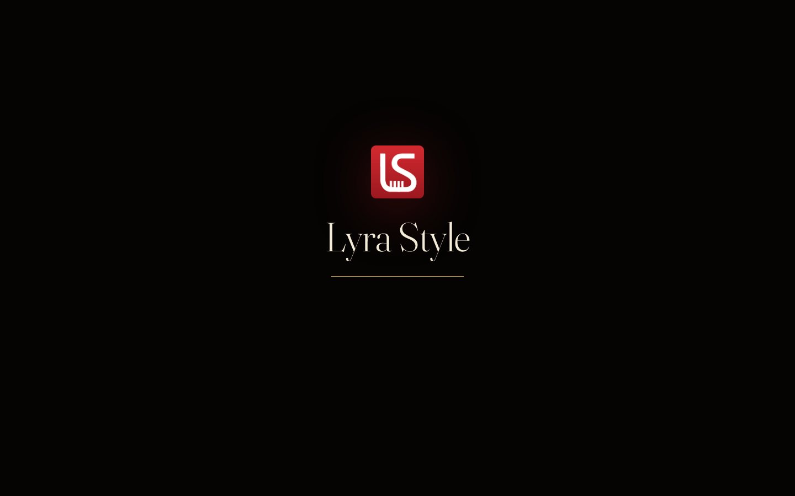
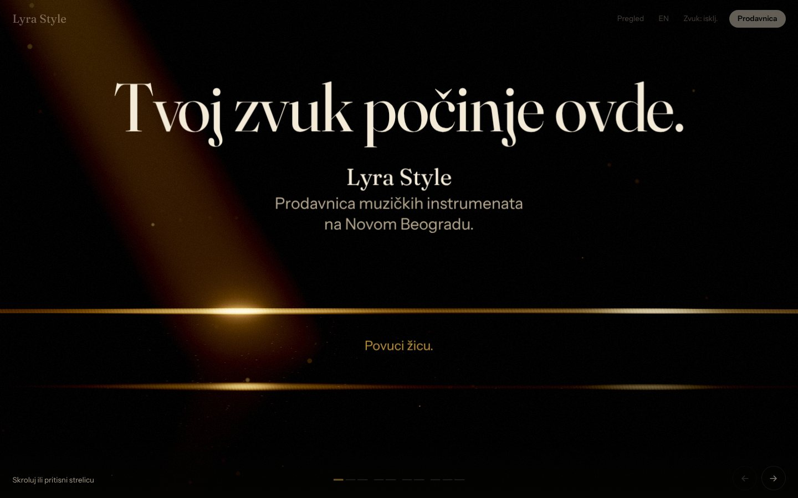
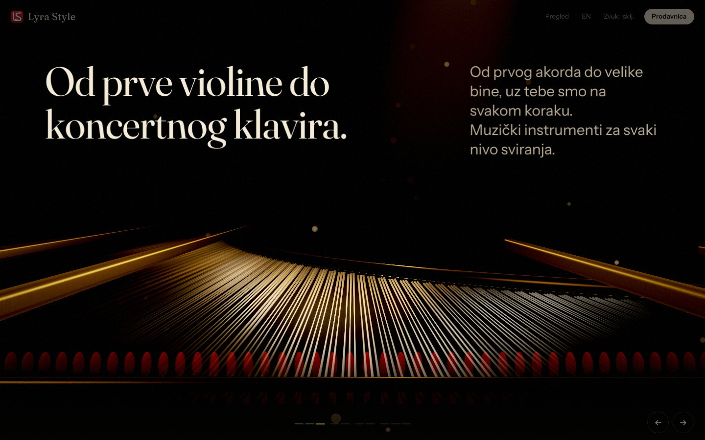
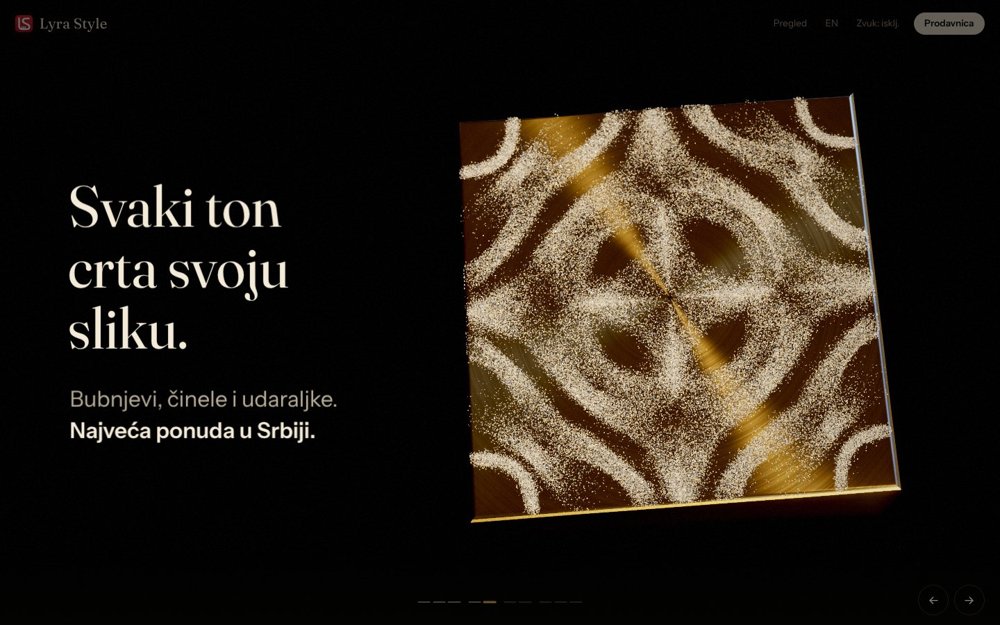
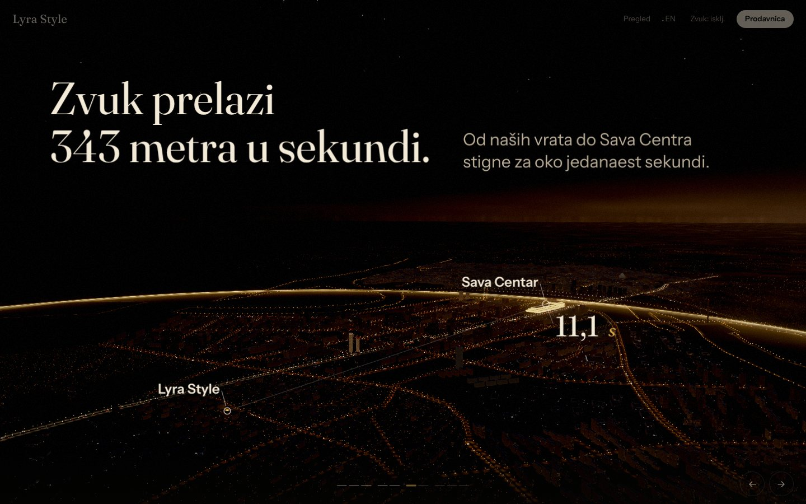
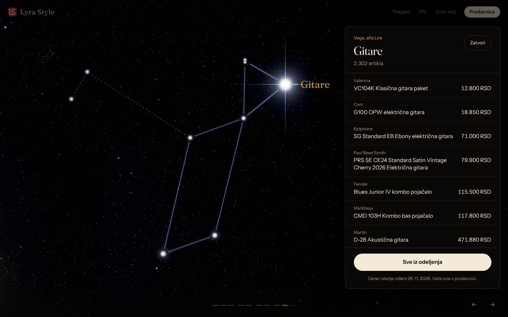
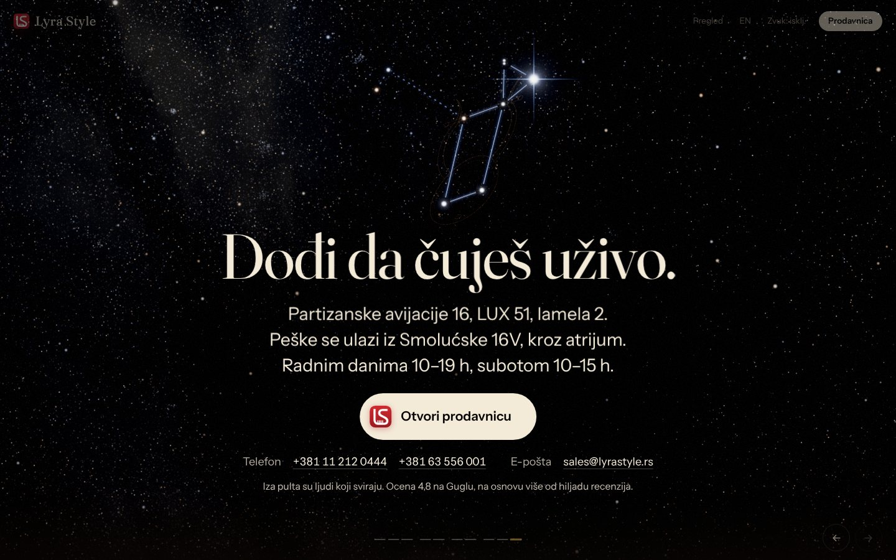

# Lyra Style – „Tvoj zvuk počinje ovde“

Interaktivna uvodna stranica (brend iskustvo) za **[lyrastyle.rs](https://lyrastyle.rs/)**.

Ovo nije zamena za postojeću prodavnicu. To je kratka priča u nekoliko scena: žica koju posetilac povuče, ploča sa peskom, zvučni talas preko Novog Beograda i sazvežđe Lira. Na kraju posetilac ide pravo u prodavnicu ili dolazi u radnju.

**Pogledaj uživo:** https://claude.ai/artifact/8brHL4SVAjgLikWgYaZ29w



---

## Sadržaj

1. [Šta je u repozitorijumu](#šta-je-u-repozitorijumu)
2. [Gde postaviti na sajt (preporuka)](#gde-postaviti-na-sajt-preporuka)
3. [Kako postaviti, korak po korak](#kako-postaviti-korak-po-korak)
4. [Kako se koristi](#kako-se-koristi)
5. [Linkovi direktno na scene](#linkovi-direktno-na-scene)
6. [Šta treba potvrditi pre objave](#šta-treba-potvrditi-pre-objave)
7. [Izmene teksta i ponovni build](#izmene-teksta-i-ponovni-build)
8. [Tehnički detalji](#tehnički-detalji)
9. [Preporuke za postojeći sajt (SEO)](#preporuke-za-postojeći-sajt-seo)

---

## Šta je u repozitorijumu

| Putanja | Šta je |
|---|---|
| **`lyra-style.html`** | **Gotova stranica. Jedan fajl (~1,6 MB) koji se postavlja na sajt.** Sve je u njemu: grafika, fontovi, zvuk, tekstovi na srpskom i engleskom. Ne učitava ništa sa interneta. |
| `dist/index.html` | Ista stranica kao gornja, pod imenom pogodnim za postavljanje u folder. |
| `src/` | Izvorni kod: scene, engine, tekstovi (`src/copy.js`, `src/copy.scenes.js`), proizvodi (`src/products.js`), podaci o radnji (`src/site.js`). |
| `tools/` | Alati za build (`build.js`), automatsku proveru (`check.js`), snimke ekrana i sličice za pregled. |
| `docs/screenshots/` | Snimci ekrana svih scena. |
| `docs/research/` | Istraživanje koje stoji iza projekta: analiza sajta i SEO, društvene mreže, konkurencija, kupci u Srbiji, brief i nezavisna recenzija. |
| `docs/razvoj/` | Tehnički ugovor između delova koda i uputstvo za razvoj (na engleskom). |
| `docs/logo.svg` | Logo pretvoren u vektor (koristi se u stranici). |

## Scene

| | Scena | Šta posetilac vidi i radi |
|---|---|---|
| 1 | **Žica** (3 koraka) | Jedna zlatna žica u mraku; posetilac je povuče i ona zazvuči. Zatim sedam žica lire, pa unutrašnjost koncertnog klavira. |
| 2 | **Ploča** (2 koraka) | Pesak na metalnoj ploči crta Hladnijeve figure; svaki udarac je nova figura i novi zvuk. Bubnjevi, činele i udaraljke. |
| 3 | **Talas** (2 koraka) | Noćni Novi Beograd odozgo. Zvučni talas kreće od radnje i stiže do Sava Centra za ~11 sekundi, u stvarnom vremenu. Klikom se pušta novi talas. Ozvučenje, mikrofoni, studio. |
| 4 | **Sazvežđe** (3 koraka) | Kamera se podiže ka nebu: sazvežđe Lira. Njegovih osam zvezda su osam odeljenja prodavnice, sa pravim proizvodima, cenama i linkovima. Na kraju adresa, radno vreme, telefoni i dugme „Otvori prodavnicu“. |

| | |
|---|---|
|  |  |
|  |  |
|  |  |

---

## Gde postaviti na sajt (preporuka)

### Preporuka: posebna adresa `lyrastyle.rs/prica/` + link sa početne strane

Stranicu postaviti kao **zaseban HTML fajl na sopstvenoj adresi**, na primer:

```
https://lyrastyle.rs/prica/
```

(alternativno `/iskustvo/` ili `/zvuk/`, bitno je da bude kratko i lako za izgovoriti i štampati).

Zatim je povezati sa postojećeg sajta na ovim mestima:

1. **Početna strana, prvi baner (hero):** dugme ili baner „Tvoj zvuk počinje ovde →“ koji vodi na `/prica/`. Ovo je najvažnije mesto.
2. **Glavni meni:** stavka „O nama“ ili „Naša priča“ koja vodi na `/prica/`. Trenutna stranica „O nama“ je prazna (Lorem ipsum), pa ovo rešava i taj problem.
3. **Instagram i Facebook:** link u opisu profila (bio) i u objavama. Za objave o konkretnom odeljenju koristiti linkove direktno na scenu (vidi [Linkovi direktno na scene](#linkovi-direktno-na-scene)).
4. **Google Business profil:** kao „Website“ ili u objavama; ljudi koji traže radnju odmah vide gde je i kako se ulazi.
5. **QR kod u radnji i na kesama/računima:** vodi na `/prica/#sazvezdje-2` (izbor odeljenja).

### Zašto zasebna adresa, a ne ugrađivanje u postojeću stranicu

- Stranica koristi **ceo ekran**, tastaturu, skrol i dodir. Unutar postojeće Bricks/WordPress stranice, meni, futer i skripte sajta bi se mešali sa njom.
- Fajl je **potpuno samostalan**: ne zavisi od teme, dodataka ni WooCommerce-a, pa ga ažuriranja sajta ne mogu pokvariti.
- Brže se učitava kad se servira direktno, bez WordPress-a.

### Šta ne preporučujemo

- **Ne zameniti početnu stranu prodavnice ovom stranicom.** Ona je brend uvod, a ne katalog. Kupci koji traže proizvod treba odmah da vide prodavnicu.
- **Ne ubacivati preko „HTML“ / „Code“ elementa u Bricks-u.** Fajl je velik (1,6 MB koda) i radi kao ceo ekran; editor i stilovi teme bi smetali.
- Ako se ipak mora ugraditi u postojeću stranicu, koristiti `<iframe>` preko celog ekrana (primer ispod), a ne kopirati kod.

---

## Kako postaviti, korak po korak

### Opcija A (preporučeno): fajl u folder na serveru

1. Preko FTP-a, SFTP-a ili File Manager-a u hosting panelu (cPanel / Plesk) otvoriti koreni folder sajta (obično `public_html/`, tamo gde je `wp-config.php`).
2. Napraviti folder **`prica`**.
3. U njega postaviti fajl **`dist/index.html`** iz ovog repozitorijuma (mora se zvati `index.html`).
4. Otvoriti `https://lyrastyle.rs/prica/` i proveriti.

WordPress neće dirati ovaj folder, jer server prvo služi fajl koji postoji, pa tek onda prosleđuje WordPress-u. Ako se ipak otvori WordPress-ova 404 strana, proveriti da li postoji stranica ili kategorija sa istim nazivom (`prica`) i izabrati drugo ime foldera.

**Preporučena podešavanja servera (opciono, za brzinu):**

- Uključiti **gzip ili Brotli** kompresiju za HTML. Fajl od 1,6 MB se tada prenosi kao ~0,7 MB.
- Keš: `Cache-Control: public, max-age=3600` za ovaj fajl. Kod ažuriranja samo zameniti fajl.

Primer za Apache (`public_html/prica/.htaccess`):

```apache
<IfModule mod_deflate.c>
  AddOutputFilterByType DEFLATE text/html
</IfModule>
<IfModule mod_headers.c>
  Header set Cache-Control "public, max-age=3600"
</IfModule>
```

### Opcija B: poddomen

Napraviti poddomen, npr. `prica.lyrastyle.rs`, i u njegov folder postaviti `dist/index.html`. Dobro ako hosting otežava rad sa folderima u korenu.

### Opcija C: ugradnja kroz iframe (samo ako mora)

Ako stranica mora da bude deo postojeće WordPress stranice, prvo uraditi Opciju A, pa u praznu stranicu (šablon bez zaglavlja i podnožja) ubaciti:

```html
<iframe src="/prica/" title="Lyra Style – tvoj zvuk počinje ovde"
        allow="autoplay; fullscreen" allowfullscreen
        style="position:fixed;inset:0;width:100%;height:100%;border:0;z-index:9999"></iframe>
```

### Link sa početne strane

Primer dugmeta za Bricks (Button element, ili Basic Text sa linkom):

- Tekst: **Tvoj zvuk počinje ovde**
- Link: `/prica/`
- Otvaranje: u istom tabu (stranica sama ima dugme „Prodavnica“ koje vodi nazad).

---

## Kako se koristi

**Za posetioca:**

- Prvi ekran: logo, ime, traka učitavanja i „Tvoj zvuk počinje ovde.“ Ulazi se **skrolom, prevlačenjem nagore, klikom ili strelicom**.
- Zvuk je uključen; dugme „Zvuk“ gore desno ga isključuje. Neki pregledači puštaju zvuk tek posle prvog klika ili dodira.
- Napred i nazad: skrol, prevlačenje na telefonu, strelice na tastaturi ili dugmad dole desno.
- **Gore desno:** „Pregled“ (sve scene kao sličice), „EN/SR“ (jezik), „Zvuk“, „Prodavnica“ (vodi na lyrastyle.rs).
- U scenama: povući žicu, udariti ploču, kliknuti na grad, izabrati zvezdu (odeljenje).

**Prečice na tastaturi:**

| Taster | Radnja |
|---|---|
| → ↓ Space Enter | dalje |
| ← ↑ | nazad |
| Home / End | početak / kraj |
| 1–4 | skok na scenu |
| O | pregled svih scena |
| L | jezik (srpski / engleski) |
| M | zvuk |
| F | ceo ekran |
| ? | pomoć |
| Esc | zatvori |

**Pristupačnost:** radi samo tastaturom, poštuje podešavanje „smanji pokrete“ (prefers-reduced-motion), čitači ekrana dobijaju tekst svake scene. Ako uređaj nema WebGL, umesto animacije se prikazuje obična tekstualna stranica sa istim sadržajem i linkovima ka odeljenjima.

---

## Linkovi direktno na scene

Svaki korak ima svoju adresu. Korisno za objave na mrežama, QR kodove i kampanje:

| Link | Šta otvara |
|---|---|
| `/prica/` | početak (ulazni ekran) |
| `/prica/#zica` | žica |
| `/prica/#zica-3` | unutrašnjost klavira („Od prve violine do koncertnog klavira“) |
| `/prica/#ploca` | ploča (bubnjevi i udaraljke) |
| `/prica/#talas` | talas preko Novog Beograda |
| `/prica/#talas-2` | ozvučenje, mikrofoni, studio |
| `/prica/#sazvezdje` | sazvežđe Lira |
| `/prica/#sazvezdje-2` | **izbor odeljenja sa proizvodima** (najbolje za QR kod) |
| `/prica/#sazvezdje-3` | adresa, radno vreme, kontakt |

---

## Šta treba potvrditi pre objave

Ovi podaci su prikupljeni sa sajta, Google profila i društvenih mreža 26. 11. 2026. Molimo da ih vlasnik potvrdi:

- [ ] **Adresa:** Partizanske avijacije 16, LUX 51, lamela 2, 11070 Novi Beograd; peške ulaz iz Smolućske 16V, kroz atrijum. (Neki imenici navode broj 6; sajt, Google i Facebook navode 16.)
- [ ] **Radno vreme:** radnim danima 10–19 h, subotom 10–15 h.
- [ ] **Telefoni i e-pošta:** +381 11 212 0444, +381 63 556 001, sales@lyrastyle.rs.
- [ ] **„Najveća ponuda u Srbiji“** (scena Ploča): tvrdnja je na zahtev naručioca; proveriti da li je opravdana.
- [ ] **„Naši sistemi rade u restoranima, ambasadama i studijima“** (scena Talas).
- [ ] **Ocena 4,8 na Google-u** iz više od 1.000 recenzija (stanje 26. 11. 2026).
- [ ] **Proizvodi i cene** u sceni Sazvežđe su „zamrznuti“ na 26. 11. 2026 (64 proizvoda na stanju, 8 po odeljenju). Na stranici piše da važe cene u prodavnici. Za osvežavanje vidi ispod.

---

## Izmene teksta i ponovni build

Potrebno: [Node.js](https://nodejs.org/) 18 ili noviji.

```bash
npm install          # jednom
npm run build        # pravi dist/index.html
```

Gde se šta menja:

| Šta | Fajl |
|---|---|
| Tekstovi scena (srpski i engleski) | `src/copy.scenes.js` |
| Tekstovi menija, ulaznog ekrana, pomoći | `src/copy.js` |
| Adresa, telefoni, e-pošta, link prodavnice | `src/site.js` |
| Proizvodi i cene u sazvežđu | `src/products.js` |
| Naslov i opis stranice (za Google i deljenje) | `src/index.template.html` |

Posle izmene: `npm run build`, pa ponovo postaviti `dist/index.html` na server.

**Napomene za tekst:**

- Novi red u tekstu se piše kao `\n`.
- Da dve reči ostanu u istom redu (npr. „nivo sviranja“), između njih staviti ` ` (neprelomni razmak).
- Ključevi (npr. `'zica.b1.h'`) se ne menjaju, menja se samo tekst posle dvotačke.

**Provera pre postavljanja (preporučeno):**

```bash
npm run check        # build + automatski test svih scena, linkova, jezika, telefona
```

Test koristi Google Chrome (`/usr/bin/google-chrome`); na drugom sistemu podesiti putanju u `tools/check.js` i `tools/shot.js`.

**Sličice u „Pregledu“** se prave iz stvarnih scena: `npm run thumbs` (posle većih vizuelnih izmena).

---

## Tehnički detalji

- **Jedan fajl, bez spoljnih zahteva.** Three.js (0.187), fontovi (Fraunces, Instrument Sans, latinica sa srpskim slovima) i svi zvuci su unutar fajla. Ne koristi kolačiće, analitiku ni spoljne servise. Jedini linkovi ka spolja su obični linkovi ka lyrastyle.rs, `tel:` i `mailto:`.
- **Sve je proceduralno:** nema fotografija ni video zapisa. Grafika se računa na grafičkoj kartici (WebGL2, sopstveni shaderi), a zvuk se sintetiše u pregledaču (Web Audio).
- **Kvalitet se sam prilagođava:** ako uređaj ne stiže da crta glatko, rezolucija i broj čestica se smanjuju.
- **Podržano:** novi Chrome, Edge, Firefox i Safari na računaru, iOS i Android. Najbolji utisak je na računaru sa slušalicama ili zvučnicima.
- **Jezik** se pamti u pregledaču posetioca (localStorage).

Struktura koda:

```
src/
  main.js               ulaz: spaja scene
  engine/deck.js        tok priče, navigacija, linkovi, pregled, ulazni ekran
  engine/gfx.js         renderer, post-obrada (bloom, ton, zrno)
  engine/text.js        tipografija unutar slike
  engine/audio.js       sinteza zvuka
  engine/transitions.js prelazi između scena
  scenes/zica.js        scena 1
  scenes/ploca.js       scena 2
  scenes/talas.js       scena 3 (mapa Novog Beograda)
  scenes/sazvezdje.js   scena 4 (odeljenja, kontakt)
```

---

## Preporuke za postojeći sajt (SEO)

Tokom analize sajta lyrastyle.rs (26. 11. 2026) uočeno je sledeće. Ovo nije deo ove stranice, ali utiče na to koliko ljudi uopšte stigne do prodavnice:

1. **Sve stranice prodavnice imaju `noindex, nofollow`.** Google ne prikazuje sajt u pretrazi. Ovo je najhitnije: u WordPress-u proveriti *Podešavanja → Čitanje → „Odvrati pretraživače“* i SEO dodatak.
2. **Stranica „O nama“ je Lorem ipsum.** Preporuka je da vodi na ovu priču ili da dobije pravi tekst.
3. **Na kontakt stranici se ispisuje `{mb_site-info_fax}`.**
4. **Nema meta opisa ni strukturiranih podataka** (LocalBusiness, Product), a ni radnog vremena na sajtu.
5. **Deo starog sajta je i dalje dostupan** pod `/product/...` adresama.

Detaljno: [`docs/research/a-site-crawl.md`](docs/research/a-site-crawl.md). Nezavisna recenzija ove stranice: [`docs/research/review.md`](docs/research/review.md).

---

## Kontakt i prava

Stranica je napravljena za Lyra Style d.o.o. Logo i naziv „Lyra Style“ pripadaju Lyra Style d.o.o. Fontovi Fraunces i Instrument Sans su pod licencom SIL Open Font License, a Three.js pod MIT licencom.
